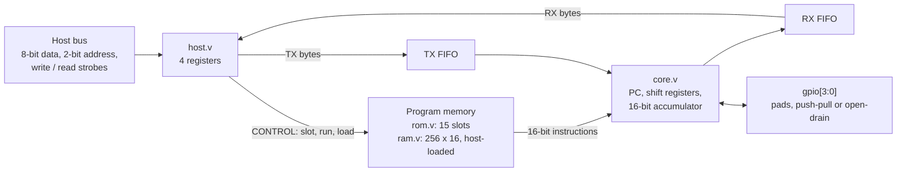

# smallcore

A small programmable protocol engine in Verilog, in the spirit of the RP2040's PIO block. A 16-bit core with four output pins, four input pins and two FIFOs runs short assembly programs that bit-bang serial protocols, so one block can act as a UART, SPI, I2C or SWD master or a Classical CAN transmitter/receiver depending on the program loaded. It exists to explore how little hardware it takes to run those protocols, and to test every protocol against a Python golden model before any silicon or board is involved.

**Status: verified in simulation and run through an open ASIC flow. Not yet tested on hardware.** See [Status](#status).

## Motivation

This started from Jane Street's [protocol emulator ASIC competition](https://blog.janestreet.com/protocol-emulator-asic-competition/): design a small, reprogrammable chip that can emulate hardware protocols like UART, SPI and I2C instead of dedicating a block to each. Their suggestion is to start with a UART transmitter on a pin and then make it programmable.

The obvious first question is how to build a general programmable protocol machine that works for any protocol. I didn't start there. I started small and asked what the minimum hardware is for just what communication needs. The process, in order:

1. **Paper first.** I mapped each protocol, up to CAN, to the least hardware that could do it.
2. **Golden model.** A Python model and assembler of that instruction set (`model/cpu.py`) before any RTL existed. I built this with AI assistance.
3. **Programs against the model.** I wrote the protocol programs in assembly and tested them against the model.
4. **RTL last.** I wrote the Verilog from the model. The same programs and the model then drive the RTL benches in `tests/rtl/`, cycle by cycle for the core and at the pins for the full chip, and they pass.

Each instruction exists because a protocol needed it: REPEAT, the run test and the CRC accumulator were added when SWD and CAN would not fit without them, and `experiments/` holds the candidates that were tried and measured.

## Block diagram



`smallcore.v` is the packaged chip (host, ROM, RAM, and `top.v`, which is the core plus its two FIFOs). `top.v` is also verified on its own.

## What runs on it

| Protocol | Programs (`programs/`) | In the ROM |
|---|---|---|
| UART | TX (fixed byte, from FIFO, looped), RX | slots 1-4 |
| SPI | TX LSB/MSB first, full duplex LSB/MSB first | slots 5-8 |
| I2C | master write, with clock stretching, address + data | slots 9-11 |
| SWD | read loop (uses `REPEAT`) | slot 12 |
| CAN (Classical, not CAN FD) | TX with CRC, RX with CRC, RX bytes | slots 13-15 |

More CAN programs (arbitration, ACK, bit stuffing, destuffing receiver, DLC-following receiver) live in `programs/can/` and are exercised at the pins in the RTL benches but are not in the ROM. 10BASE-T Ethernet transmit is an experiment in `experiments/ethernet/`, not a supported program.

## How it is verified

Three layers, all in this repo:

1. **Golden model**: `model/cpu.py` is a Python model and assembler of the ISA defined in `isa/isa.yaml`. `tests/model/` (3,893 tests) checks the assembler, every instruction, and each protocol program against the model, including CAN frames, CRC, bit stuffing and error cases.
2. **RTL against the model**: `tests/rtl/` runs `rtl/*.v` under Verilator with cocotb. 11 test modules cover the core, FIFO, host bus, ROM, RAM, the top level with every program driven at the pins, the packaged chip through its host bus, and the PYNQ-Z2 wrapper in simulation.
3. **Generated ROM is checked**: `make rom-check` fails if `rtl/rom.v` differs from what `tools/gen_rom.py` produces from `programs/manifest.txt`.

```bash
python3 -m venv .venv && . .venv/bin/activate
pip install -r requirements.txt     # also needs Verilator on PATH
make test         # rom-check + model tests + RTL tests (about 8 minutes)
make test-model   # pytest tests/model only (about 6 minutes)
make test-rtl     # pytest tests/rtl only (about 2 minutes)
make lint         # Verilator lint, warnings do not fail
```

On the last run (2026-10-14): 3,893 model tests and 11 RTL test modules passed.

## Status

- **Simulation**: model and RTL tests pass, as above.
- **ASIC flow**: hardened through the Tiny Tapeout IHP CMOS5L flow (LibreLane) at 6x4 tiles, with zero DRC, antenna and LVS violations on each recorded row. Cell counts, area and timing per milestone are in [docs/physical-results.md](docs/physical-results.md). The slow corner of one earlier row had 26 max-slew violations on three ROM address-decode nets; they were noted and not fixed.
- **Not done**: no FPGA board run (the PYNQ-Z2 project in `fpga/pynq_z2/` has only been simulated), no silicon, no measurement against real UART/SPI/I2C/SWD/CAN devices or a real CAN bus. The chip-level bench drives the UART and SPI slots through the host bus; the I2C, SWD and CAN programs are verified at the `top.v` level, not yet from the ROM through the host bus.
- **Known limits**: the CAN receiver cannot hold raw history, data and CRC at once, and its ACK cannot depend on the CRC. No ROM slot is free. `SKIP_RUN` is in the ISA but no ROM program uses it.

## Repository layout

| Path | Contents |
|---|---|
| `isa/` | `isa.yaml`: instruction set, encoding, operand ranges |
| `model/` | `cpu.py`: golden Python model and assembler |
| `rtl/` | Verilog-2001: core, FIFO, top, host bus, ROM (generated), RAM, packaged chip |
| `programs/` | assembly per protocol, `manifest.txt` maps ROM slots |
| `tests/` | `model/` (pytest) and `rtl/` (cocotb) |
| `tools/` | ROM generator, doc renderer, waveform helper |
| `experiments/` | the CAN, CRC, REPEAT, accumulator and Ethernet experiments that shaped the ISA |
| `asic/janestreet/` | Tiny Tapeout packaging and flow scripts |
| `fpga/pynq_z2/` | Vivado project script and wrapper |
| `docs/` | deeper material, below; `docs/diagrams/` holds Mermaid sources and rendered SVGs |

## Deeper docs

- [Instruction set](docs/isa.md) and [host interface](docs/host-interface.md)
- [Design history, status log and design pressures](docs/design-history.md)
- [Commands](docs/commands.md) and [diagrams](docs/diagrams/README.md)
- [Original design spec for the program ROM, host bus and FPGA smoke test](docs/design/programmable-peripheral.md)
- [CAN](docs/can-combined.md), [CAN candidates](docs/can-candidates.md), [CAN stress](docs/can-stress.md)
- [CRC](docs/crc-baselines.md), [REPEAT](docs/repeat-candidates.md), [10BASE-T](docs/ethernet-10baset.md)
- [Physical results](docs/physical-results.md)
