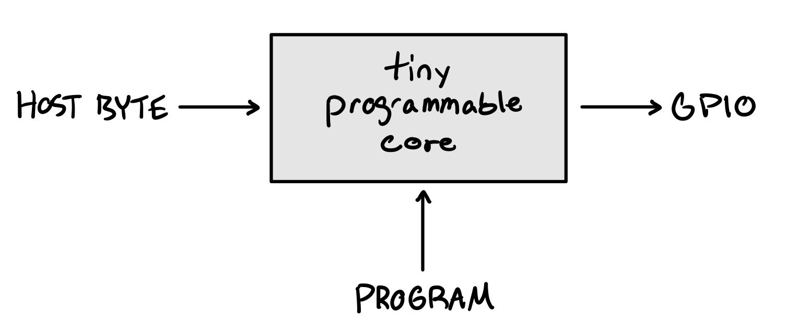
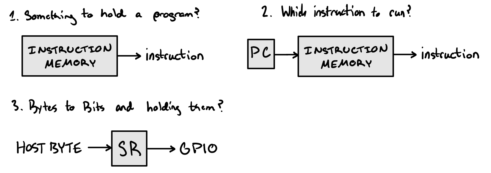
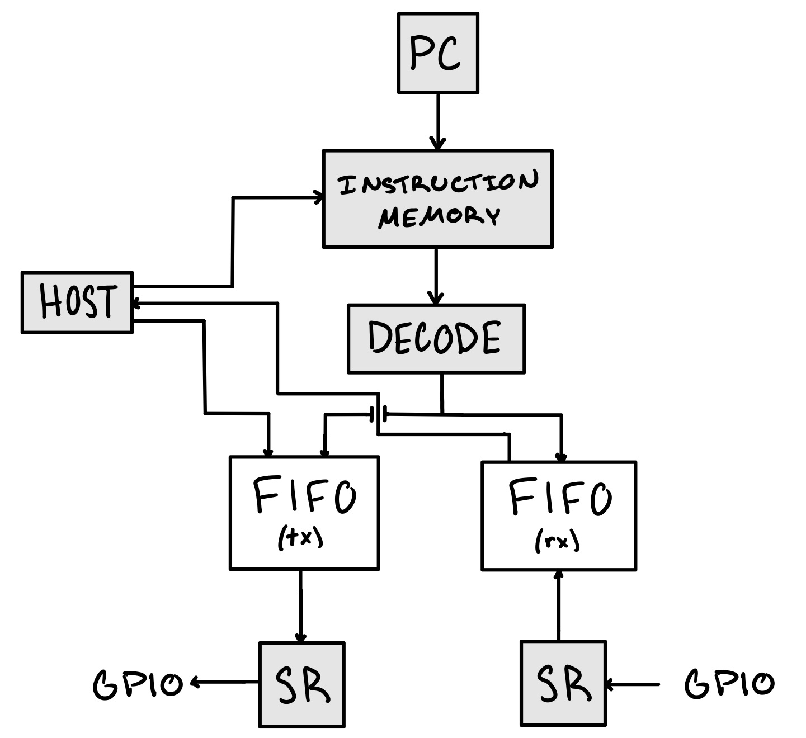
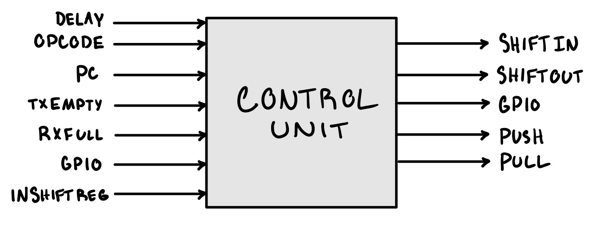
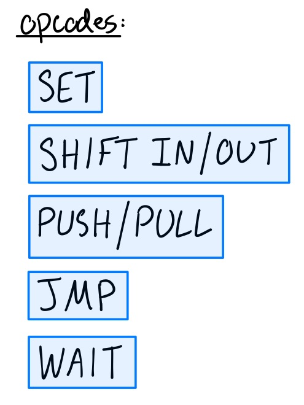
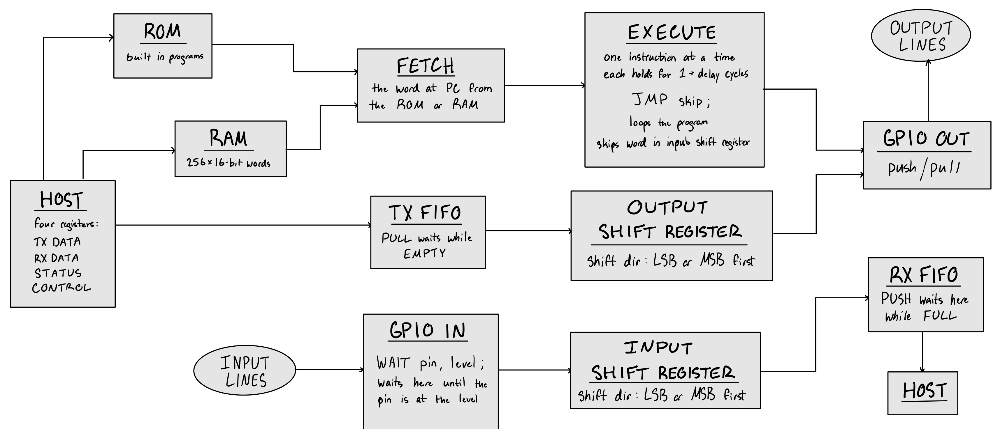

# Design sketches

Hand-drawn notes from before the RTL existed. They are early: the opcode list below is the first five groups, not the final instruction set (see [isa.md](isa.md) for the 18 mnemonics).

## Start small

The starting point was one box: a host byte goes in, a program is loaded, GPIO comes out.

Then three questions, each answered with the least hardware that would do: something to hold a program, something to say which instruction runs next, and something to turn bytes into bits and hold them.

## First datapath

Those three parts joined up, with a TX and an RX FIFO between the host and the pins.

## Control unit and first opcodes

## Block diagram

The datapath once it had program memory (ROM and a 256 x 16 RAM), four host registers, and the stall points: PULL waits while the TX FIFO is empty, PUSH waits while the RX FIFO is full, WAIT holds until the pin is at the level.

